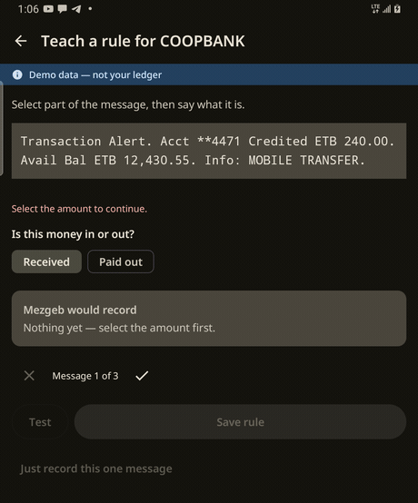
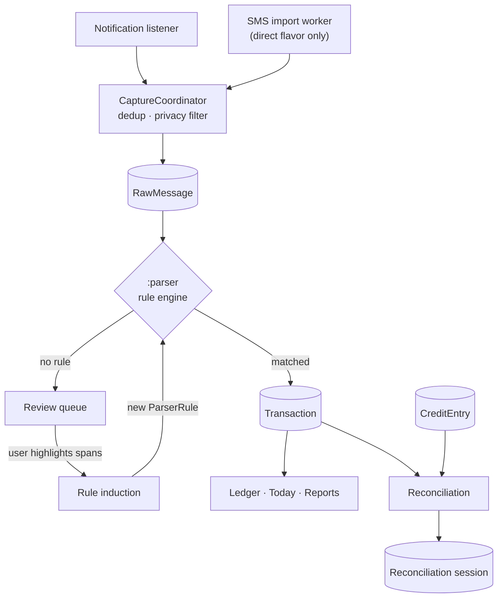

# Mezgeb (መዝገብ)

An offline Android app that reads mobile-money payment notifications, parses them into a
ledger, tracks who owes the shop money, and reconciles the two — built for small shops in
Ethiopia, with no network permission and no account to sign up for.



> _GIF placeholder — the teach-a-rule interaction, recorded on device._

**Read-only with respect to money.** The app never initiates, sends, or authorizes a
payment.

---

## The Play Store constraint

The obvious way to build this is to read the SMS inbox. Google Play will not let you.

`READ_SMS` and `RECEIVE_SMS` are restricted permissions: Play grants them only to apps
whose *core* purpose requires being the device's default SMS handler. A finance app that
wants to read payment confirmations is explicitly not an eligible use case, and the
policy covers placeholder declarations too — you cannot ship the permission dormant and
switch it on later. An app that declares it without qualifying gets rejected, and the
rejection is a policy strike, not a bug report.

So Mezgeb captures payments a second way. A `NotificationListenerService` reads the
notifications that telebirr, CBE Birr and bank apps post when money moves. That needs no
restricted permission — the user grants notification access in system settings, sees
exactly what they granted, and can revoke it in the same place. It works on both flavors.

The trade-off is real and worth stating: notification capture only sees a payment while
the notification exists, so it cannot backfill history the way an inbox read can. That is
why there are two flavors:

| | `play` | `direct` |
|---|---|---|
| Distribution | Play Store | Sideloaded APK |
| Live capture | Notification listener | Notification listener |
| Historical backfill | — | One-time SMS inbox import |
| SMS permissions | **None** | `READ_SMS`, `RECEIVE_SMS` |

The SMS permissions exist in exactly one file, `app/src/direct/AndroidManifest.xml`, and
nothing in `src/main` mentions them — not in code, not in a comment, not as placeholder
text. The merged `play` release manifest is checked to contain zero SMS permissions:

```
$ ./gradlew :app:assemblePlayRelease
$ grep -c 'permission.INTERNET\|SMS' \
    app/build/intermediates/merged_manifest/playRelease/*/AndroidManifest.xml
0
```

## The adaptive parser

Payment messages are not a documented format. They change without notice, they differ per
bank, and a hardcoded regex is a maintenance liability from the day it ships.

`:parser` is a rule engine: versioned, JSON-defined patterns compiled at runtime, with
field extraction and normalization for amounts, phone numbers and dates. When no rule
matches, the message lands in a **review queue** instead of being dropped. The user
highlights the amount and the sender in the message body, and the app *induces a new rule*
from those spans — generalising the highlighted values while anchoring the literal text
around them. The next message from that sender parses on its own.

**Accuracy: 100.00% on the holdout (23/23), 100.00% on train + noise (95/95)** — zero
false positives, zero wrong values, across a corpus of 84 financial and 34 noise messages
from 3 senders.

**That figure is worth less than it looks, and [CORPUS.md](CORPUS.md) says so at length.**
The holdout holds out samples, not templates: both splits come from the same 3 senders and
13 message templates, from one person's account, with no Amharic transaction messages. It
measures resistance to overfitting on values, not generalisation to an unseen provider —
which is what a reader assumes a holdout number means. The corpus falls short of its own
targets of 150 samples and 4 senders. The number becomes meaningful when those are met.

A wrong value is treated as fatal and fails the build. A *missed* message is not: it goes
to the review queue, where the user fixes it. Those are different failures and the project
does not average them together.

## Architecture



Every captured message passes one funnel, `CaptureCoordinator`, which applies the sender
allowlist and the credential filter before anything is written. Messages from people are
never stored; messages stating a PIN or one-time code are never stored. One policy, one
place for it to be wrong.

**Modules**

```
:app       Android application — Compose UI, Room, capture services, DI
:parser    Pure Kotlin/JVM — rule engine, normalization, rule induction.
           Zero Android dependencies, so it tests in plain JUnit against the corpus.
```

**Stack** — Kotlin 2.x / JDK 17 · Jetpack Compose + Material 3 · single Activity ·
Navigation Compose · Room + KSP · Hilt · WorkManager · DataStore ·
kotlinx.serialization · MVVM with unidirectional data flow

**Testing** — 365 unit tests on `play`, 372 on `direct`, 83 on `:parser`. DAOs tested
against in-memory Room, ViewModels with Turbine, migrations against the committed schema
JSON rather than hand-copied DDL. Coverage is 35.6% instruction / 45.7% line, reported
rather than gated — `./gradlew :app:jacocoPlayDebugReport`. The Compose screen bodies are
the bulk of what is uncovered, deliberately. See [NOTES.md](NOTES.md) for the three
least-tested areas that *should* be covered, and why two of the others cannot be.

## Privacy

- **No `android.permission.INTERNET`, in either flavor.** Not a policy, a build fact —
  verified against the merged release manifest. The app has no network stack, no
  analytics SDK and no crash reporter; a stack trace is something you read off the screen.
- Raw message bodies never leave the device and are never logged. Amount and sender may
  appear in debug output; the body may not.
- Backups are AES-256-GCM with a PBKDF2-derived key. The passphrase is never stored.
- The app lock holds a PIN behind PBKDF2 in a Keystore-backed `EncryptedSharedPreferences`.
- **Corpus:** collected from the author's own device, filtered to financial and
  promotional shortcodes *before* any body text was read. 15 messages from personal
  numbers were discarded unread. Names, phone numbers, account numbers and transaction
  references are redacted with length and character class preserved — the properties the
  parser learns. 19 messages containing one-time codes were excluded entirely rather than
  redacted, because a redacted credential is still a credential in a git history.
  `CorpusValidationTest` fails the build on anything resembling an unredacted number.
  Full method in [CORPUS.md](CORPUS.md).

## Build

Requires JDK 17 and the Android SDK. No keys or secrets are needed for a debug build.

```bash
# Play-compliant build — no SMS permissions
./gradlew :app:assemblePlayDebug

# Sideload build — adds the one-time SMS inbox import
./gradlew :app:assembleDirectDebug

# Everything: both flavors, all unit tests, lint
./gradlew build

# Parser accuracy against the fixture corpus
./gradlew :parser:test --tests '*CorpusAccuracyTest*'
```

Install: `adb install app/build/outputs/apk/play/debug/app-play-debug.apk`

On first launch the app asks for notification access. **Settings → Demo mode** seeds a
90-day shop — transactions, customers carrying credit, a filled review queue and a closed
reconciliation period — so the app can be evaluated in ten seconds without waiting for a
real payment to arrive. Disabling it points the app back at the real ledger, untouched.

### Release builds

Release builds are R8-minified and signed from a gitignored `keystore.properties` at the
repository root:

```properties
storeFile=mezgeb-release.jks
storePassword=…
keyAlias=mezgeb
keyPassword=…
```

Without that file the release build still compiles and stays **unsigned**, rather than
falling back to the debug key — a debug-signed APK installs and runs and looks exactly
like a release, signed with a key every Android SDK on earth has the private half of.

Release APK size is 3.07 MB for both flavors.

## License

Not yet chosen.
